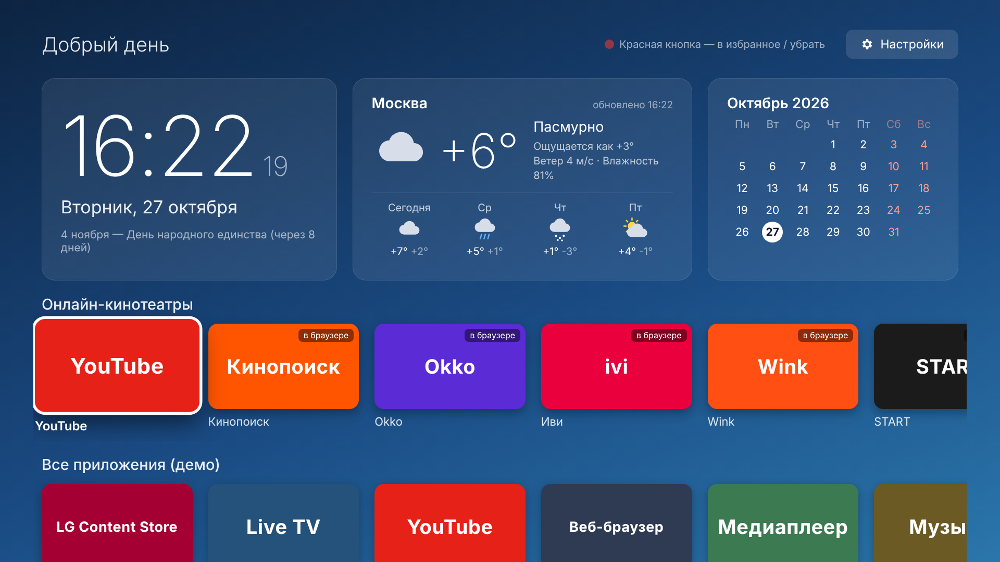

# nowau — «Мой ТВ»: лаунчер и медиацентр для LG webOS

Главный экран для телевизоров LG на webOS. Делался и проверялся под **LG UJ639V (webOS 3.5)**,
но должен работать на webOS 3.x и новее.



## Что внутри

- **Часы** с секундами, датой, приветствием по времени суток и ближайшим праздником.
- **Погода**: сейчас и на 4 дня, с иконками. Данные берутся из бесплатного [Open-Meteo](https://open-meteo.com), ключ не нужен. Город выбирается в настройках.
- **Календарь** на месяц: выходные и праздники РФ выделены, сегодняшний день отмечен.
- **Онлайн-кинотеатры**: YouTube, Кинопоиск, Okko, Иви, Wink, START, KION, PREMIER, RUTUBE.
  Если приложение сервиса установлено, запускается оно. Если нет, сервис открывается во встроенном браузере.
- **Все приложения** телевизора одним рядом и **Избранное**: на нужной плитке нажмите красную кнопку пульта.
- Фон меняется по времени суток: утро, день, вечер, ночь.

## Управление пультом

| Кнопка | Действие |
|---|---|
| Стрелки | перемещение по плиткам |
| OK | открыть приложение. На карточке погоды открываются настройки |
| 🔴 Красная | добавить приложение в избранное или убрать его |
| 🟢 Зелёная | обновить погоду |
| Назад | закрыть настройки. Двойное нажатие — выход |
| Magic Remote | указка и колёсико тоже работают |

## Установка на телевизор

Нужен компьютер (Windows, macOS или Linux) в той же Wi-Fi-сети, что и телевизор.

### 1. Включите режим разработчика на ТВ
1. Зарегистрируйтесь на <https://webostv.developer.lge.com> (бесплатно).
2. На телевизоре откройте **LG Content Store**, найдите и установите приложение **Developer Mode**.
3. Запустите его, войдите под своим аккаунтом и включите **Dev Mode Status**. Телевизор перезагрузится.
4. Снова откройте Developer Mode и включите **Key Server**. Запишите IP-адрес телевизора, он показан на экране.

### 2. Установите инструменты на компьютер
Нужен [Node.js](https://nodejs.org) версии 16 или новее.
```bash
npm install -g @webos-tools/cli
```

### 3. Подключите телевизор
```bash
ares-setup-device
#   add → имя: tv → IP: <IP телевизора> → порт: 9922 → пользователь: prisoner
ares-novacom --device tv --getkey
#   введите Passphrase, которую показывает Developer Mode на экране ТВ
```

### 4. Соберите и установите
Команды выполняются в папке репозитория:
```bash
ares-package tv-launcher -o dist
ares-install --device tv dist/com.nowau.launcher_1.0.0_all.ipk
ares-launch  --device tv com.nowau.launcher
```
Приложение **«Мой ТВ»** появится в ленте приложений. Чтобы оно было под рукой, перетащите его в начало ленты:
нажмите и удерживайте OK на иконке, затем сдвиньте её.

### Важно про режим разработчика
Режим разработчика включается на ограниченное время: счётчик показан в приложении Developer Mode.
Срок продлевается кнопкой **Extend**.
Если срок истечёт, установленные приложения разработчика удалятся. Чтобы не следить за этим вручную,
можно поставить [Homebrew Channel](https://www.webosbrew.org): у него есть автопродление.

## Ограничения
- **Заменить системный главный экран (Home) без root нельзя.** «Мой ТВ» запускается как обычное приложение.
  С root через Homebrew Channel можно настроить его автозапуск при включении телевизора.
- Список установленных приложений берётся из системного сервиса webOS. Если прошивка не даёт к нему доступ,
  ряд «Все приложения» не появится, но кинотеатры, часы, погода и календарь будут работать.
- Сайты онлайн-кинотеатров во встроенном браузере webOS 3.5 могут работать медленно или вовсе не поддерживаться.
  Если у сервиса есть приложение в LG Content Store, лучше установить его: лаунчер найдёт его автоматически.

## Разработка

Достаточно открыть `tv-launcher/index.html` в браузере на компьютере. Без телевизора включается демо-режим
с примерами приложений. Код написан на ES5 без сборщиков, потому что браузер webOS 3.5 основан на Chromium 38.

```
tv-launcher/
  appinfo.json        описание приложения для webOS
  index.html          разметка экрана
  css/style.css       оформление (размеры в rem, масштабируется под 720p/1080p)
  js/util.js          общие помощники, хранилище настроек
  js/luna.js          вызовы системных сервисов webOS (запуск приложений)
  js/clock.js         часы, приветствие, фон
  js/calendar.js      календарь и праздники
  js/weather.js       погода Open-Meteo и поиск города
  js/apps.js          ряды плиток, кинотеатры, избранное
  js/nav.js           навигация стрелками пульта
  js/settings.js      окно настроек
  js/main.js          запуск и обработка кнопок пульта
```

Список кинотеатров можно изменить в массиве `CINEMAS` в `tv-launcher/js/apps.js`.
